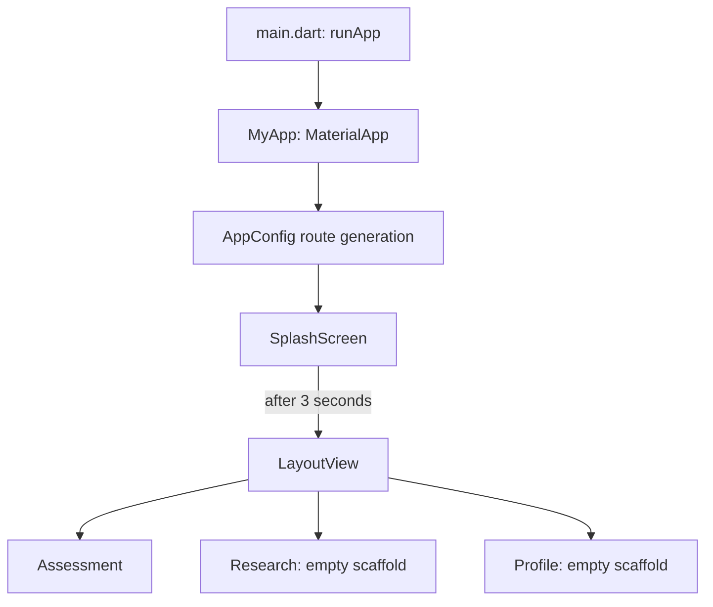

# FedHealth

FedHealth is a Flutter mobile application prototype for a federated-learning research workflow. The
current app presents a patient-assessment interface with an explicitly illustrative survival result
and navigation shells for Research and Profile. It is a UI prototype: the source does not implement
model inference, federated training, persistence, authentication, or a backend connection.

## Features currently present

- A branded splash screen, shown for three seconds before navigating to the main layout.
- Bottom navigation between Assessment, Research, and Profile.
- An assessment form with age, year, and nodes text fields.
- A fixed example result labelled "Illustrative confidence"; it is static UI and is not derived from
  entered values.
- Shared button and text-field widgets, a light theme, and bundled Inter fonts and SVG/image assets.
- Android and iOS Flutter platform projects.

The Assessment action currently has an empty callback. Research and Profile render empty scaffolds.
The assessment screen itself warns that its demo data is for research only and not for clinical
decision support.

## Technology

- Flutter and Dart (the `pubspec.yaml` constraint is `^3.12.2`).
- Material widgets, with `cupertino_icons` and `flutter_svg` as declared runtime packages.
- `flutter_test` and `flutter_lints` as development dependencies.
- Android Gradle Kotlin DSL and an iOS Xcode project for native platform integration.

No state-management, routing, networking, database, or dependency-injection package is declared.
Routes and UI state use Flutter built-in APIs.

## Architecture and application flow

The code is organized by feature with a small shared core and reusable widgets. The `LayoutView`
feature contains empty `data layer` and `domain` directory scaffolding, but no implemented data
sources, repositories, use cases, or models. The active behavior is concentrated in presentation
widgets.



`MyApp` selects the splash route, installs `AppConfig.onGenerateRoute`, and applies
`AppThemeManager.lighttheme`. The splash screen uses `Navigator.pushNamed` to open the main layout
after its delay. The bottom navigation changes the selected child locally with `setState`; it does
not navigate to the separately declared Research/Profile route names.

## Project structure

```text
assets/
  fonts/                 Inter font files
  icons/                 SVG icons and marks
  images/                Image assets
lib/
  main.dart              Flutter entry point and MaterialApp setup
  Features/
    splashScreen/        Splash screen
    LayoutView/
      data layer/        Empty data-source/repository implementation scaffolding
      domain/            Empty repository/use-case scaffolding
      presentation/
        manager/         Empty presentation manager scaffolding
        pages/           Assessment, LayoutView, Research, Profile
  Widgets/               Shared ButtonWidget and TextFieldWidget
  core/
    AppConfig/           Named route generation
    AppRoutes/           Route-name constants
    Themes/              App colors and light theme
    gen/                 Generated asset and font accessors
android/                 Android host project and Gradle configuration
ios/                     iOS host project and Xcode configuration
test/                    Flutter widget-test source
pubspec.yaml             Dart/Flutter dependencies and asset declarations
analysis_options.yaml    Dart analyzer/lint configuration
```

## Requirements

- Flutter SDK with Dart satisfying the constraint in `pubspec.yaml` (`^3.12.2`).
- A configured Android toolchain for Android builds, or Xcode on macOS for iOS builds.

The project metadata records Flutter's `stable` channel, but does not document a specific required
Flutter SDK version. Android/iOS SDK versions are taken from the Flutter Gradle configuration where
applicable.

## Setup and run

From the repository root:

```sh
flutter pub get
flutter run
```

To target a particular connected device, list devices with `flutter devices`, then run
`flutter run -d <device-id>`.

There are no application environment variables or API credentials configured in the inspected
source. Android Gradle settings load the local Flutter SDK path from the standard, machine-specific
`android/local.properties` file; Flutter tooling normally creates/configures this file locally.

## Tests and analysis

Run the Flutter test suite with:

```sh
flutter test
```

The repository contains one widget test, but it is still the default counter-app smoke test and
expects counter UI that the current application does not provide. It therefore does not represent
valid coverage for the present app and is expected to fail unless updated. Static analysis can be
run with `flutter analyze`; the root analyzer configuration includes `flutter_lints`.

## API and data integration

No API endpoints or network integration are implemented in the inspected Dart source and declared
dependencies. Assessment values are held in text controllers, but are not submitted or evaluated.
The displayed "Positive" result and 88.5% confidence are hard-coded illustrative content. The UI
labels the model as "Haberman - FedAvg global model," but the code does not implement the Haberman
dataset processing, federated averaging, or a prediction model.

## Implementation status and limitations

- Assessment page layout and sample outcome are present; prediction logic and form validation are
  absent.
- Research and Profile pages are placeholders.
- The `Research` and `Profile` route-name constants exist, but route generation does not map those
  names; the displayed tabs are rendered directly by `LayoutView`.
- The existing test targets the default Flutter counter template rather than this app.
- Android release configuration currently uses the debug signing configuration, as noted in
  `android/app/build.gradle.kts`; production release signing is not configured.

No project plan or actionable feature TODOs were found beyond the platform-template Android
application ID and release-signing TODOs.
