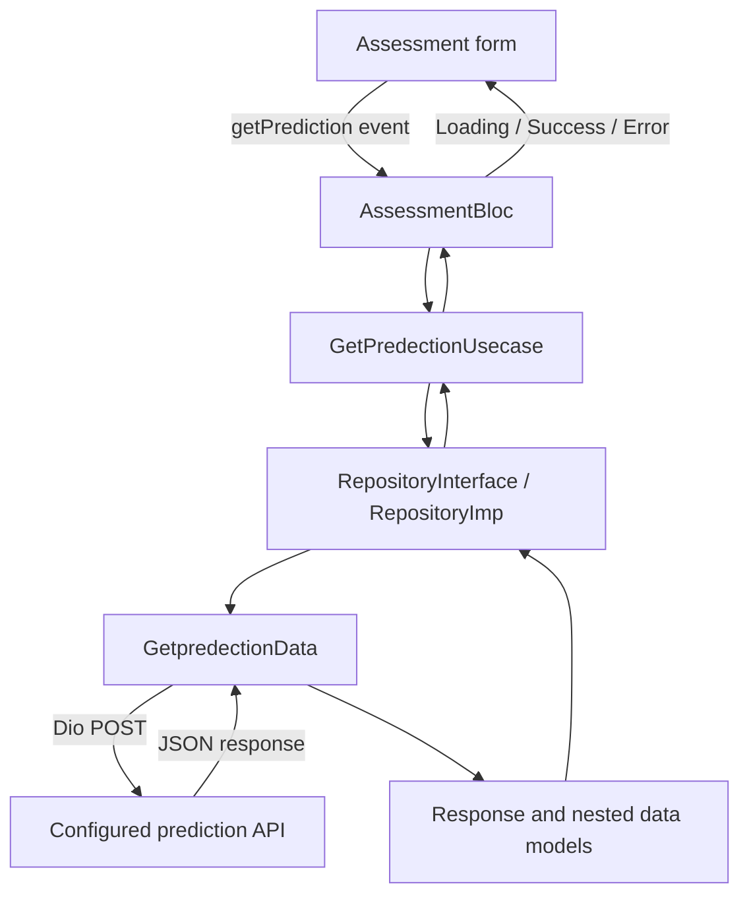

# FedHealth

FedHealth is a Flutter application prototype for a federated-learning health research workflow. Its
current interactive feature is a patient assessment form that submits age, operation year, and
positive lymph-node count to a prediction API and displays the returned prediction record. The
interface describes the result as research/demo output and not for clinical decision support.

## Current features

- Branded splash screen followed by a bottom-navigation shell for Assessment, Research, and Profile.
- Assessment form for age, operation year, and positive nodes.
- Prediction request handling through a BLoC, repository, use case, and Dio remote data source.
- Loading, success, and error presentation states on the assessment screen.
- Response parsing for the prediction result and associated administrator and hospital records.
- Shared button and text-field widgets, a light Inter-based theme, and bundled SVG/image assets.

Research and Profile currently render empty scaffolds. No authentication, persistence, federated
training, or on-device model inference is implemented in this Flutter source. The app displays a
research-only notice; prediction output must not be treated as clinical advice.

## Technology

- Flutter and Dart (Dart SDK constraint `^3.12.2` in `pubspec.yaml`).
- Material UI and `flutter_svg` for SVG assets.
- `flutter_bloc` and `equatable` for assessment state and value comparisons.
- `dio` for HTTP requests and `get_it` for dependency registration.
- `skeletonizer` and `flutter_bounceable` are declared dependencies; assessment uses `skeletonizer`
  for loading presentation.
- `cupertino_icons`; development dependencies `flutter_test` and `flutter_lints`.

## Architecture and data flow

The code is grouped by feature with shared application configuration, theme, routes, and dependency
setup under `lib/core/`.



The Assessment page creates an `AssessmentBloc`. When the user taps **Run Prediction Model**, the
page reads the three text controllers, creates a `PredectionRequestModel`, and dispatches a
`getPrediction` event. The BLoC emits loading, awaits the use case and repository, then emits
success with a parsed response or error with an exception message. The page uses `Skeletonizer`
while loading and renders result or error content for the corresponding state.

`GetpredectionData` sends a JSON POST request using Dio. Its request body contains `age`,
`operationYear`, and `positiveNodes`. `PredectionResponseModel.fromJson` reads `success`, `result`,
and a `data` list. Each list item is parsed into a prediction data model, including nested
administrator and hospital models. The repository throws when the parsed `success` field is false.

### API configuration

The base URL is currently a constant in `lib/core/AppConstant/AppConstant.dart`, and the path is
declared in `lib/core/EndPoints/EndPoints.dart`. No environment-file mechanism or credentials are
configured in the inspected source. The configured base URL already includes `/api/v1/predict`,
while the request path also equals `/api/v1/predict`; Dio combines these values, so verify the
intended server URL/path before relying on a live request. The backend contract and deployment
availability are not documented in this repository.

The request model's `tojson()` method is not used by the remote data source; the data source builds
the request map directly. The assessment form does not currently validate or convert the text values
before constructing the request, while the domain request fields are strings. API/network and
parsing errors are caught by the BLoC and surfaced through the error state.

## Dependency injection and navigation

`SettingDI()` registers a lazy `RepositoryInterface` implementation and `GetPredectionUsecase` in
GetIt; `main()` calls this setup before `runApp`. The BLoC retrieves the use case from this locator.
Routes are generated in `lib/core/AppConfig/AppConfig.dart`; the splash route is the initial route.
The bottom navigation changes the selected page locally with `setState`. Research and Profile
route-name constants exist, but route generation currently maps only splash, Assessment, and
LayoutView.

## Project structure

```text
assets/                         Fonts, icons, and images
lib/
  Features/
    splashScreen/               Splash screen
    LayoutView/
      data layer/
        Models/                 Prediction, administrator, and hospital JSON models
        dataSource/             Dio remote prediction request
        repositoryImp/           Prediction repository implementation
      domain/
        Entities/                Request and response entities
        repository/              Repository contract
        Usecases/                Prediction use case
      presentation/
        manager/                 Assessment BLoC, events, and states
        pages/                   Assessment, layout, Research, and Profile screens
  Widgets/                       Shared button and text-field widgets
  core/
    AppConfig/                   Route generation
    AppRoutes/                   Route-name constants
    AppConstant/                 API base URL constant
    DI/                           GetIt registrations
    EndPoints/                   API path constants
    Themes/                       App colors and light theme
    gen/                          Generated asset/font accessors
test/                             Widget tests
android/ and ios/                 Native Flutter platform projects
pubspec.yaml                      Package, asset, and font configuration
```

## Requirements and setup

- Flutter SDK with Dart satisfying the `^3.12.2` constraint.
- Android toolchain for Android builds, or macOS with Xcode for iOS builds.

From the repository root, install packages and launch on a connected device or emulator:

```sh
flutter pub get
flutter devices
flutter run
```

To select a device explicitly, use `flutter run -d <device-id>`. Flutter tooling may require a
machine-specific `android/local.properties` file for the local SDK path. No additional application
environment variables or API credentials are specified in the inspected source.

## Tests and analysis

Run the repository's test command with:

```sh
flutter test
```

The current `test/widget_test.dart` is still the default counter-app smoke test, despite the
application no longer displaying a counter, so it does not provide valid coverage for the current
UI. Static analysis can be run with `flutter analyze`; `analysis_options.yaml` enables the
`flutter_lints` rules.

## Development status

- Implemented in the current source: assessment form submission wiring, prediction API
  request/response parsing, DI registration, BLoC loading/success/error states, and a research-use
  notice.
- Present as UI placeholders: Research and Profile screens.
- Not established by the checked-in Flutter code: federated model training, inference
  implementation, authentication, persistence, form validation, and robust API/environment
  configuration.
- The assessment response parser expects a `data` list and nested administrator/hospital fields.
  Confirm that shape and the combined API URL against the backend contract before integration use.
- Android release signing still uses the debug signing configuration as indicated in
  `android/app/build.gradle.kts`; production release signing is not set up.
